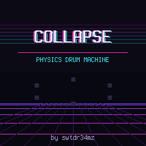

# COLLAPSE

A physics drum machine for the M-VAVE FM-1 by **swtdr34mz**, inspired by the 3D physics synth Anukari. Built on
[fm1-base](https://github.com/charlesvestal/fm1-base) and [felucca-bsp](https://github.com/hugelton/felucca-bsp).

Six synthesized instruments hang in a **web of springs**. Every hit is a push: the instrument struck jumps to new
parameters, and its neighbours in the web get shoved too. The springs pull everything back to the sound you set, so
no two hits sound the same and the groove never falls apart. Glitch, dubstep, DnB, LXR.

 

## The web

Each instrument is a mass on four springs, one per knob. The display shows the six masses live (top right): a hit
makes its mass jump, the ties carry the push on, the ringed one is the instrument picked. The sliders below are the
instruments' "equaliser": the thumb shows how hard each one moves, the colour under it its level.

Two macros rule the web, on the two encoders left of the screen:

| Encoder | Macro | Sweetspots |
| --- | --- | --- |
| **SELECT** | **MASS**: the inertia. Light: big, fast, nervous jumps that settle at once. Heavy: slow, long swings. It also moves all six at once: heavy is lower, longer and dirtier, light is higher, shorter and cleaner | FEATHER, LIGHT, NEUTRAL, HEAVY, BLACK HOLE |
| **ALGORITHM** | **CHAOS**: which instruments are tied to which, and how hard every hit pushes and how loosely the springs hold. At the top the hits start to stutter | CHAIN, RING, STAR (all on the kick), MESH (all with all) |

## The six instruments

| Key | Instrument | K1 | K2 | K3 | K4 |
| --- | --- | --- | --- | --- | --- |
| 1 | **KICK** (sine, pitch sweep, click) | TUNE: SUB, DEEP, PUNCH, TIGHT | PUNCH: SOFT, CLICK, ZAP, LASER | DECAY: SHORT, TIGHT, 808, BOOM | DIRT: CLEAN, WARM, DISTORT, SHRED |
| 2 | **SNARE** (two tones and filtered noise) | TUNE: FAT, DNB, TIGHT, PICCOLO | SNAP: BODY, CRACK, NOISE, WHITE | DECAY: GHOST, TIGHT, ROOM, GATED | DIRT |
| 3 | **HATS** (the 808's six squares and noise) | TUNE: DARK, 808, BRIGHT, TINY | DECAY: TICK, CLOSED, HALF, OPEN | METAL: NOISE, MIX, METAL, RING | DIRT: ... 8 BIT, 4 BIT |
| 4 | **GLITCH** (a square chopped into stutters, each chop a random pitch) | RATE: SLOW, STUTTER, BUZZ, SWARM | PITCH: LOW, MID, HIGH, DATA | LENGTH: BLIP, SHORT, BURST, SMEAR | CRUSH: CLEAN, BITS, BROKEN, DEAD |
| 5 | **PERC** (a knock into two resonators, LXR-style) | TUNE: LOW, TOM, BELL, TICK | DECAY: KNOCK, SHORT, RING, DRONE | RESO: WOOD, SKIN, METAL, GLASS | DIRT |
| 6 | **BASS** (a reese: two saws and a sub, a wobble in time) | NOTE: E1, B1, E2, B2, E3 | DECAY: PLUCK, SHORT, LONG, HOLD | WOBBLE: NONE, 1/4, 1/8, 1/16, SCREAM | DIRT: CLEAN, REESE, GROWL, SHRED |

Every knob rests a few detents on its sweetspots when turned slowly; the sweetspot's name lights up big in the display.
The bass ducks under the kick.

## The pages

| Button | Page | K1 | K2 | K3 | K4 |
| --- | --- | --- | --- | --- | --- |
| HOME | **SOUND** (the instrument's body) | its four knobs (above) | | | |
| EDIT | **ENGINE** (the instrument's own effects) | FM: OFF, WARBLE, BELL, NOISE | GRAIN: OFF, HAZE, CLOUD, SPRAY | FILTER: DARK, LOW, OPEN, THIN, AIR | CHAOS: STILL, LOOSE, BOUNCE, AVALANCHE |
| ENV | **EXCITE** (how the body is struck) | TYPE: MALLET, PLUCK, BOW, BRUSH | HARDNESS: FELT, SOFT, AS IS, HARD, STEEL | POSITION: CENTRE, INNER, AS IS, OUTER, RIM | BOUNCE: DEAD, FLAM, RATTLE, BUZZ |
| LFO | **MOTION** (a slow movement, in time) | RATE: 1 BEAT .. 16 BARS | DEPTH: OFF, DRIFT, SWAY, WILD | SHAPE: SINE, SAW, RANDOM, BOUNCE | TARGET: the instrument's four knobs, or PITCH |
| SEL | **WEB** (the springs themselves) | TENSION: SLACK .. STEEL | DAMPING: ENDLESS .. DEAD | REACH: FAINT .. WILD | LINK (the picked instrument): APART, LOOSE, TIED, WELDED |
| FX | **FX** (the master) | DRIVE: CLEAN, GLUE, HOT, MELT | SPACE: DRY, ROOM, HALL, VOID | PITCH: -12, -5, 0, +7, +12 | GLITCH: OFF, SKIP, STUTTER, SHRED |
| GLO | **GENERAL** | BPM | SWING: STRAIGHT, SHUFFLE, DRUNK | DRIFT: GRID, HUMAN, LOOSE, FREE | LENGTH: the picked track's steps, 1-64 |

The same button again goes back to SOUND.

- **EXCITE** as in Anukari, where mallets, plectrums and bows are parts of their own: **BOW** draws a bow across the
  body for a beat (real stick-slip friction: the body sings on its own note for as long as the bow is drawn), **PLUCK** a
  sharp push at the rim, **BRUSH** a scrape of noise. HARDNESS and POSITION change the body's own mallet (64: as it is);
  BOUNCE lets the mallet spring back: a flam, a rattle, a buzz. TYPE, SHAPE and TARGET move a whole choice a click.
- **MOTION**: each instrument's own slow movement, on the beat: a knob of its own, or its pitch (by time in the body),
  swayed by a sine, a ramp, a random step each turn, or a ball's hops.
- **WEB**: how stiff the springs are, how long the web keeps wobbling after a hit, how far it moves the knobs; and how
  firmly the picked instrument is tied in (APART: nothing pushes it, it pushes nothing).
- **FM**: the sound read from a short line whose length swings at audio rate (phase modulation): a warble, bells, noise.
- **GRAIN**: two grains from the last 46 ms, at half, the same or twice the speed.
- **CHAOS** (an instrument's own): how easily the web pushes it, and the chance that a hit **bounces**: it strikes again
  and again, each time sooner and softer, like a ball coming to rest.
- **PITCH**, as in Anukari: time in the bodies runs faster or slower. Every frequency and every decay moves together.
- **GLITCH**: at a step, by chance, the last slice of the mix is caught and repeated for a step or two, sometimes backwards.
- **DRIFT**: the hits land late, as far as the web has pushed the instrument: off the grid.
- **LENGTH**: every track has its own length. A track of 7 against 12 against 16: the bar never comes round the same.

## The eight patterns

Played like a physics instrument, not a drum machine (an Anukari recording was the reference: no grid to speak of,
hits in clusters, tones ringing into each other, the weight in the low mids). Few steps; the bounces fill in. PRESET
turns through them; while playing, the next one takes over **on the next beat**, from its top. Edits stay in their
slot; **HOME held 1 s** puts a pattern back to its factory state.

| # | Pattern | Character | BPM | Track lengths |
| --- | --- | --- | --- | --- |
| 1 | MARBLE RUN | bouncing, tonal | 128 | 16, 12, 10, 7, 16, 32 |
| 2 | SPRING TANK | loose, springy | 96 | 16, 9, 9, 5, 12, 32 |
| 3 | FOUNDRY | LXR metal | 112 | 16, 11, 13, 13, 13, 16 |
| 4 | GRAVITY WELL | black hole, heavy | 70 | 16, 16, 16, 11, 11, 32 |
| 5 | CLOCKWORK | tight ticks, 3 against 4 | 120 | 16, 8, 12, 4, 16, 16 |
| 6 | RAIN ON TIN | balls on metal | 84 | 10, 13, 7, 5, 11, 22 |
| 7 | FRACTURE | broken DnB | 170 | 26, 16, 22, 15, 17, 26 |
| 8 | AVALANCHE | everything pushes everything | 140 | 16, 14, 12, 9, 11, 24 |

## Performance (ARP)

**ARP** turns PERF mode on: the white keys become 16 pads, active while held; the six instruments' keys become
**mutes** (a press mutes, the next unmutes); the five black keys right of them are **live FX**, held.

| Pad | | Pad | |
| --- | --- | --- | --- |
| 1 | **COLLAPSE**: the springs torn: everything struck and shoved at once, everything shakes everything, the pitch falls; let go, it springs back | 9 | **TAPE STOP**: slower and slower; let go, it is back |
| 2 | **ZERO-G**: no mass: everything light, high, and every hit bounces | 10 | **SWEEP**: a low-pass closing over a bar, opening in a beat |
| 3 | **BLACK HOLE**: all the mass: deeper, longer, dirtier | 11 | **DRIFT**: every hit off the grid |
| 4 | **FREEZE**: the last sixteenth, round and round | 12 | **AVALANCHE**: CHAOS full, every hit bounces |
| 5 | **REWIND**: backwards, faster and faster | 13 | **SHIFT UP**: time in the bodies twice as fast (an octave up) |
| 6 | **REPEAT 1/8** | 14 | **SHIFT DOWN**: half as fast (an octave down) |
| 7 | **REPEAT 1/16** | 15 | **BREAK**: no kick, no bass |
| 8 | **REPEAT 1/32** | 16 | **DROP**: from the top, now, with a collapse |

| Black key | Live FX (held) |
| --- | --- |
| 7 | GATE: chopped in thirty-seconds |
| 8 | HALF TIME |
| 9 | LO-FI: a quarter of the rate, 5 bits |
| 10 | SPACE THROW: the room opened wide |
| 11 | STUTTER: GLITCH full |

### MUTATE: the knobs in PERF mode

In PERF mode the four knobs transform the whole pattern live. Each click moves 8 (sixteen clicks end to end, no rests):
the first click is already heard. **HOME** puts all four back to clean.

| Knob | MUTATE | What it does |
| --- | --- | --- |
| K1 | **ERODE**: INTACT, PITTED, CORRODED, EATEN | Acid eats holes in the pattern: hits go missing, the holes spread to their neighbours every bar, the hits next to a hole turn brittle (softer, late). Turned back, it heals |
| K2 | **MORPH**: AS SET, TOY, GLASS, RUBBER, BRUTAL | All six sounds through four worlds: tiny and clean, sweet and ringing, bouncy and deep, dirty and heavy (with each world's pitch, room, drive and bounce) |
| K3 | **ENTANGLE**: APART, PAIRS, ROTATE, SCATTER | The instruments trade bodies: the kick's pattern played on the bass string, the snare's on the perc ... then rotating, then any body at random. The rhythm stays, the kit changes |
| K4 | **RIPPLE**: STILL, ECHO, WAVES, SWARM | Every hit runs through the web: the instruments tied to it echo it (on the grid, then off it), at the top the echoes echo |

## MIDI in: COLLAPSE follows

Over USB and the TRS jack: **MIDI clock** (24 a quarter), **START**, **CONTINUE** and **STOP**. While a clock comes in
the display shows EXT SYNC and the steps follow it. Notes 36-41 (any channel) play the six instruments.

Settings and the eight patterns save themselves a few seconds after the last change.

## Building

    git clone --recursive https://github.com/swtdr34mz-afk/COLLAPSE
    X0X_FONTSET=terminus python3 fm1-base/tools/build.py . --host
    build/host/collapse_host tests/basic.txt build/host

GitHub Actions builds the installable `.fwsc` on every push (Actions tab > the run > Artifacts). A tag `v0.1.0` makes a
release with it.

## Licence

MPL-2.0. All code of COLLAPSE is its own; fm1-base and felucca-bsp are MPL-2.0 too. See [CREDITS.md](CREDITS.md).
