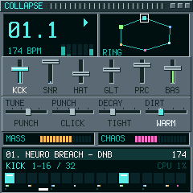

# COLLAPSE

A physics drum machine for the M-VAVE FM-1 by **swtdr34mz**, inspired by the 3D physics synth Anukari. Built on
[fm1-base](https://github.com/charlesvestal/fm1-base) and [felucca-bsp](https://github.com/hugelton/felucca-bsp).

Six synthesized instruments hang in a **web of springs**. Every hit is a push: the instrument struck jumps to new
parameters, and its neighbours in the web get shoved too. The springs pull everything back to the sound you set, so
no two hits sound the same and the groove never falls apart. Glitch, dubstep, DnB, LXR.

 

## The web

Each instrument is a mass on four springs, one per knob. The display shows the six masses live (top right): a hit
makes its mass jump, the ties carry the push on, the ringed one is the instrument picked. The sliders below are the
instruments' "equaliser": the thumb shows how hard each one moves, the colour under it its level.

Two macros rule the web, on the two encoders left of the screen:

| Encoder | Macro | Sweetspots |
| --- | --- | --- |
| **SELECT** | **MASS**: the inertia. Light: big, fast, nervous jumps that settle at once. Heavy: slow, long swings. It also moves all six at once: heavy is lower, longer and dirtier, light is higher, shorter and cleaner | FEATHER, LIGHT, NEUTRAL, HEAVY, BLACK HOLE |
| **ALGORITHM** | **CHAOS**: which instruments are tied to which, and how hard every hit pushes and how loosely the springs hold. At the top the hits start to stutter | CHAIN, RING, STAR (all on the kick), MESH (all with all) |

## The six instruments

| Key | Instrument | K1 | K2 | K3 | K4 |
| --- | --- | --- | --- | --- | --- |
| 1 | **KICK** (sine, pitch sweep, click) | TUNE: SUB, DEEP, PUNCH, TIGHT | PUNCH: SOFT, CLICK, ZAP, LASER | DECAY: SHORT, TIGHT, 808, BOOM | DIRT: CLEAN, WARM, DISTORT, SHRED |
| 2 | **SNARE** (two tones and filtered noise) | TUNE: FAT, DNB, TIGHT, PICCOLO | SNAP: BODY, CRACK, NOISE, WHITE | DECAY: GHOST, TIGHT, ROOM, GATED | DIRT |
| 3 | **HATS** (the 808's six squares and noise) | TUNE: DARK, 808, BRIGHT, TINY | DECAY: TICK, CLOSED, HALF, OPEN | METAL: NOISE, MIX, METAL, RING | DIRT: ... 8 BIT, 4 BIT |
| 4 | **GLITCH** (a square chopped into stutters, each chop a random pitch) | RATE: SLOW, STUTTER, BUZZ, SWARM | PITCH: LOW, MID, HIGH, DATA | LENGTH: BLIP, SHORT, BURST, SMEAR | CRUSH: CLEAN, BITS, BROKEN, DEAD |
| 5 | **PERC** (a knock into two resonators, LXR-style) | TUNE: LOW, TOM, BELL, TICK | DECAY: KNOCK, SHORT, RING, DRONE | RESO: WOOD, SKIN, METAL, GLASS | DIRT |
| 6 | **BASS** (a reese: two saws and a sub, a wobble in time) | NOTE: E1, B1, E2, B2, E3 | DECAY: PLUCK, SHORT, LONG, HOLD | WOBBLE: NONE, 1/4, 1/8, 1/16, SCREAM | DIRT: CLEAN, REESE, GROWL, SHRED |

Every knob rests a few detents on its sweetspots when turned slowly; the sweetspot's name lights up big in the display.
The bass ducks under the kick.

## The eight patterns

Each with its own sounds, tempo, MASS and CHAOS. PRESET turns through them; while playing, the next one starts at the
top of the loop. Edits stay in their slot; **HOME held 1 s** puts a pattern back to its factory state.

| # | Pattern | Genre | BPM | Steps |
| --- | --- | --- | --- | --- |
| 1 | NEURO BREACH | DnB | 174 | 32 |
| 2 | RIDDIM GRAVITY | Dubstep | 140 | 32 |
| 3 | GLITCH HOP | Glitch | 105 | 16 |
| 4 | LXR INDUSTRIAL | LXR | 130 | 16 |
| 5 | JUNGLE FRACTURE | Jungle | 170 | 32 |
| 6 | BREAK SHIFT | Breaks | 128 | 32 |
| 7 | MICRO GLITCH | Minimal | 122 | 16 |
| 8 | HALFTIME 174 | Halftime | 174 | 32 |

## Controls

| Control | What it does |
| --- | --- |
| Black keys 1-6 | The six instruments: a key picks it (and plays it while stopped). SEQ held + a key: mute |
| White keys | The picked instrument's 16 steps on the page shown: a tap turns a step on, again ACCENT, again off |
| K1..K4 | The instrument's four knobs; on the FX page BPM, SWING, DRIVE, SPACE |
| SELECT / ALGORITHM | MASS / CHAOS |
| PRESET | The eight patterns |
| FX | The master page (again: back). HOME: the instrument's page |
| HOME held 1 s | The pattern back to its factory state |
| SEQ | The length: 16, 32, 48, 64 steps (a new bar starts as a copy of the first) |
| OCT- / OCT+ | The page of steps shown (1-16 .. 49-64) |
| PLAY | Start from step 1 / stop |
| REC held 1 s | The picked instrument's steps cleared |

## MIDI in: COLLAPSE follows

Over USB and the TRS jack: **MIDI clock** (24 a quarter), **START**, **CONTINUE** and **STOP**. While a clock comes in
the display shows EXT SYNC and the steps follow it. Notes 36-41 (any channel) play the six instruments.

Settings and the eight patterns save themselves a few seconds after the last change.

## Building

    git clone --recursive https://github.com/swtdr34mz-afk/COLLAPSE
    X0X_FONTSET=terminus python3 fm1-base/tools/build.py . --host
    build/host/collapse_host tests/basic.txt build/host

GitHub Actions builds the installable `.fwsc` on every push (Actions tab > the run > Artifacts). A tag `v0.1.0` makes a
release with it.

## Licence

MPL-2.0. All code of COLLAPSE is its own; fm1-base and felucca-bsp are MPL-2.0 too. See [CREDITS.md](CREDITS.md).
